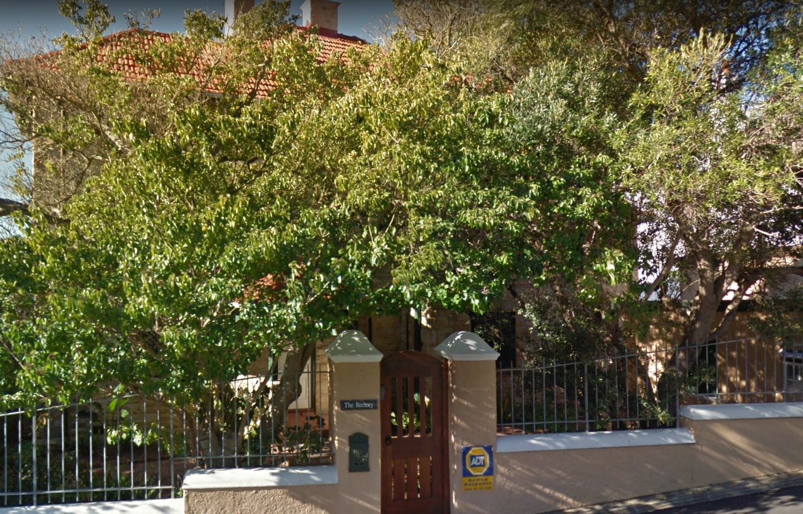
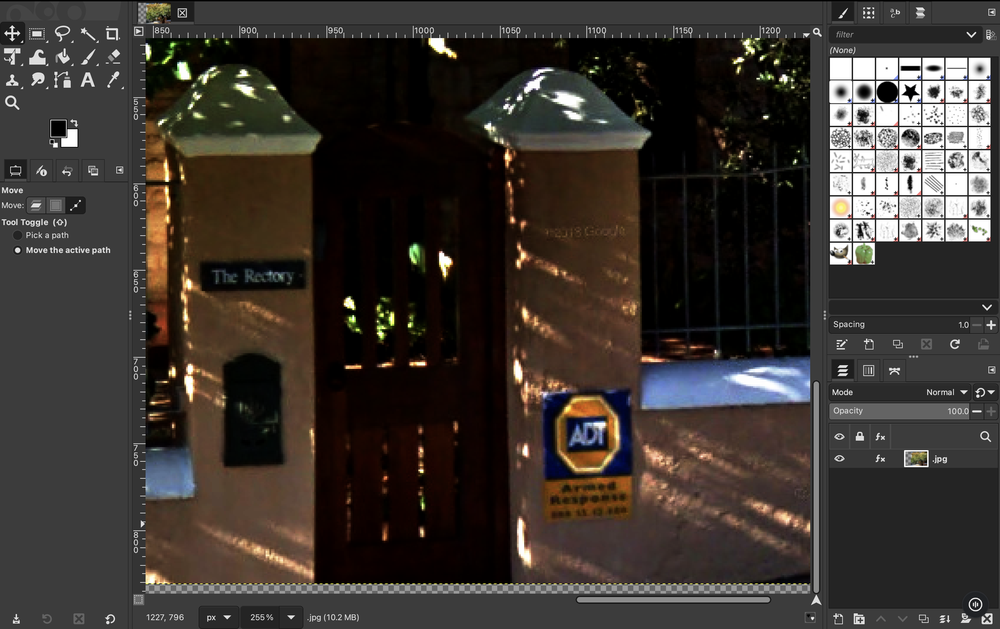
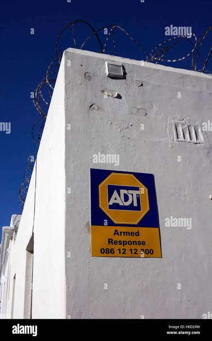
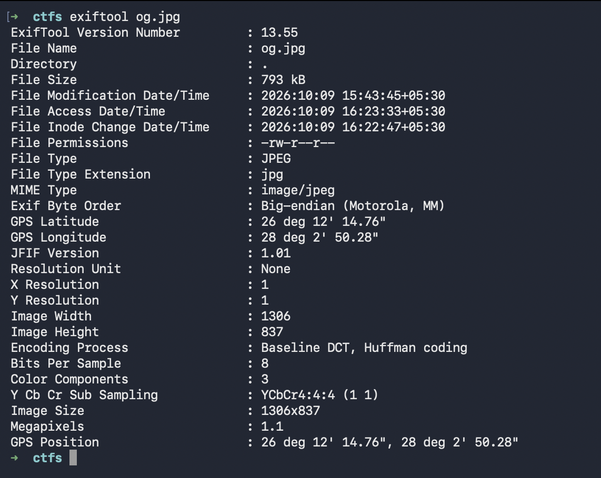
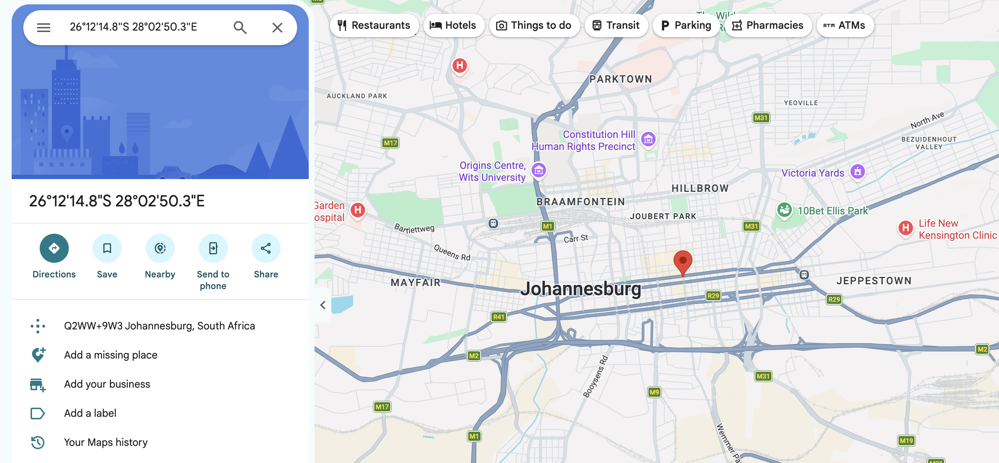
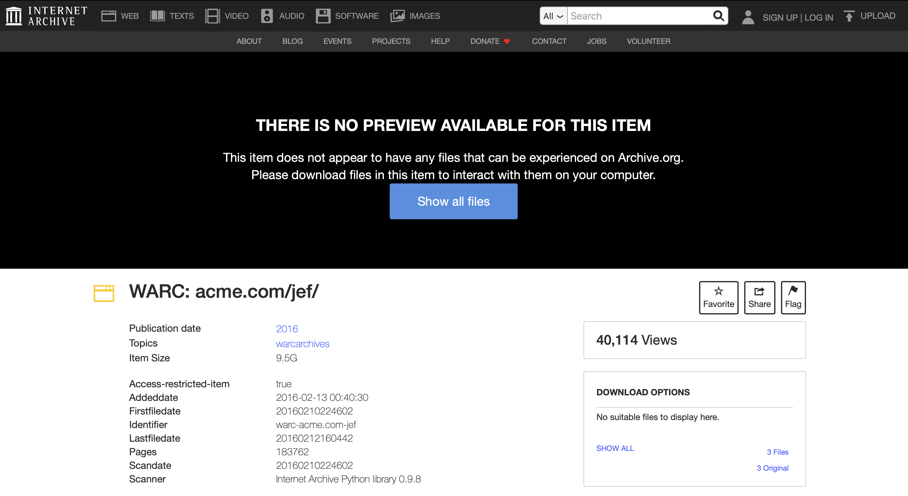
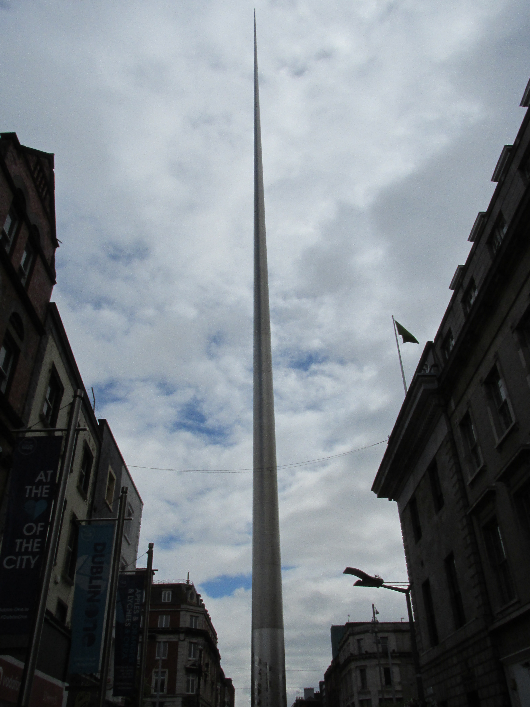
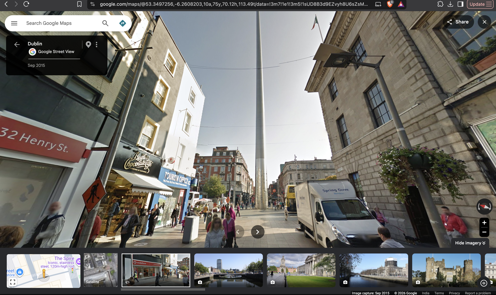
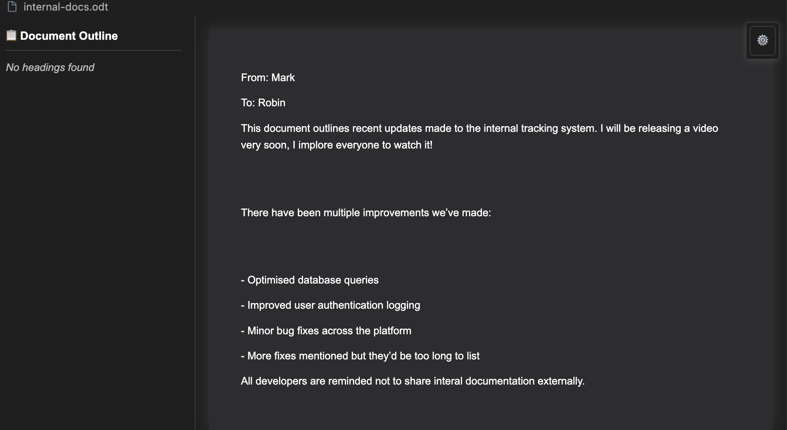

# Digital Footprint — CTF Writeup

## Task 1: The Leaked Photo (og.jpg)


### Visual & Signage Analysis

First question is to find the city this picture is from. The question describes this estate being linked to early operations of ACME Jet. 
The image shows a house with name 'The Rectory', and a sign which seems to spell out 'ADT'.



'The Rectory' term means an official residence provided by the church to the rector or any other church official.
A Google search of term 'ADT' reveals it is a home security company:

- <https://www.adt.com/resources/history-of-the-yard-sign>
- <https://1000logos.net/adt-logo/>

The sign in our image matches. The text size and how the letters overlap is the same. 

 



Found this other sample image of the sign with similar colour and shapes.

The GIMP image analysis confirms that the signage reads "armed response 086 12 12 300".

ADT offers its service across US, Canada and some parts of Puerto Rico.
Not all of its services are available in all these regions.
This can be used to narrow down the list of areas.

ADT provides armed response service in:
- South Africa (Johannesburg, Cape Town, Durban, Pretoria, Gqeberha (Port Elizabeth), Bloemfontein, Sandton, Midrand, Centurion, Pietermaritzburg, George)  
- USA (Los Angeles, Las Vegas)

Going back to the number given in the sign:

The same number is given on the [Fidelity ADT Contact Us](https://adt.co.za/customer-support/contact-us/) website, which belongs to an ADT subsidiary called Fidelity ADT. This subsidiary is South Africa specific.

The number we see is also specific to coastal region.


### ExifTool & GPS Geolocation



ExifTool reveals quite a lot of useful metadata:

```text
ExifTool Version Number         : 13.55
File Name                       : og.jpg
Directory                       : .
File Size                       : 793 kB
File Modification Date/Time     : 2026:10:09 15:43:45+05:30
File Access Date/Time           : 2026:10:09 16:23:33+05:30
File Inode Change Date/Time     : 2026:10:09 16:22:47+05:30
File Permissions                : -rw-r--r--
File Type                       : JPEG
File Type Extension             : jpg
MIME Type                       : image/jpeg
Exif Byte Order                 : Big-endian (Motorola, MM)
GPS Latitude                    : 26 deg 12' 14.76"
GPS Longitude                   : 28 deg 2' 50.28"
JFIF Version                    : 1.01
Resolution Unit                 : None
X Resolution                    : 1
Y Resolution                    : 1
Image Width                     : 1306
Image Height                    : 837
Encoding Process                : Baseline DCT, Huffman coding
Bits Per Sample                 : 8
Color Components                : 3
Y Cb Cr Sub Sampling            : YCbCr4:4:4 (1 1)
Image Size                      : 1306x837
Megapixels                      : 1.1
GPS Position                    : 26 deg 12' 14.76", 28 deg 2' 50.28"
```
The metadata contains GPS position, longitude, latitude.
Opening the coordinates in Google Maps shows Johannesburg city.



Flag:
```text
THM{Johannesburg}
```

---

## Task 2: Verifying the Founding Date (warc-acme.com/jef/)


### Wayback Machine & Metadata Archive

As per second question, attempts to go to `warc-acme.com/jef/` were made.
Link failed as DNS not found.



Wayback Machine came to the rescue.
I found an archive. Downloaded the zip, unzipped it.
It contained a `files.xml`, `meta.sqlite`, `meta.xml`.

`meta.xml` had the following metadata in it:

```xml
<metadata>
  <identifier>warc-acme.com-jef</identifier>
  <scanner>Internet Archive Python library 0.9.8</scanner>
  <subject>warcarchives</subject>
  <title>WARC: acme.com/jef/</title>
  <publicdate>2016-02-13 00:40:30</publicdate>
  <mediatype>web</mediatype>
  <collection>archiveteam_earlywarcs</collection>
  <uploader>lifesaver@textfiles.com</uploader>
  <addeddate>2016-02-13 00:40:30</addeddate>
  <curation>[curator]validator@archive.org[/curator][date]20160213004048[/date][comment]checked for malware[/comment]</curation>
  <backup_location>ia906100_1</backup_location>
  <collection>archiveteam</collection>
  <imagecount>183762</imagecount>
  <firstfiledate>20160210224602</firstfiledate>
  <lastfiledate>20160212160442</lastfiledate>
  <scandate>20160210224602</scandate>
  <date>2016</date>
  <access-restricted-item>true</access-restricted-item>
</metadata>
```
The first file date (`<firstfiledate>`) when submitted as flag worked:

```text
THM{20160210224602}
```

---

## Task 3: Identifying the Landmark (og2.JPG)

Now in the next question we are given another image: `og2.JPG`.



### ExifTool Inspection

```text

ExifTool Version Number         : 13.55
File Name                       : og2.JPG
Directory                       : .
File Size                       : 2.8 MB
File Modification Date/Time     : 2026:10:09 16:53:19+05:30
File Access Date/Time           : 2026:10:09 16:55:32+05:30
File Inode Change Date/Time     : 2026:10:09 16:55:30+05:30
File Permissions                : -rw-r--r--
File Type                       : JPEG
File Type Extension             : jpg
MIME Type                       : image/jpeg
JFIF Version                    : 1.01
Exif Byte Order                 : Big-endian (Motorola, MM)
Image Description               : 
Make                            : Canon
Camera Model Name               : Canon PowerShot SX160 IS
Orientation                     : Horizontal (normal)
X Resolution                    : 180
Y Resolution                    : 180
Resolution Unit                 : inches
Software                        : Microsoft Windows Live Photo Gallery14.0.8051.1204
Modify Date                     : 2017:07:04 11:10:36
Y Cb Cr Positioning             : Co-sited
Exposure Time                   : 1/1250
F Number                        : 8.0
ISO                             : 160
Sensitivity Type                : Standard Output Sensitivity and Recommended Exposure Index
Exif Version                    : 0230
Date/Time Original              : 1980:01:01 00:00:22
Create Date                     : 1980:01:01 00:00:22
Components Configuration        : Y, Cb, Cr, -
Compressed Bits Per Pixel       : 3
Shutter Speed Value             : 1/1244
Aperture Value                  : 8.0
Max Aperture Value              : 3.5
Flash                           : Off, Did not fire
Focal Length                    : 5.0 mm
Maker Note Byte Order           : Little-endian (Intel, II)
Warning                         : [minor] Adjusted MakerNotes base by 76
Macro Mode                      : Normal
Self Timer                      : Off
Quality                         : Fine
Canon Flash Mode                : Off
Continuous Drive                : Single
Focus Mode                      : Single
Record Mode                     : JPEG
Canon Image Size                : Large
Easy Mode                       : Full auto
Digital Zoom                    : None
Contrast                        : Normal
Saturation                      : Normal
Sharpness                       : 0
Camera ISO                      : Auto
Metering Mode                   : Evaluative
Focus Range                     : Auto
AF Point                        : Face Detect
Canon Exposure Mode             : Easy
Lens Type                       : n/a
Max Focal Length                : 80 mm
Min Focal Length                : 5 mm
Focal Units                     : 100/mm
Max Aperture                    : 3.6
Min Aperture                    : 8
Flash Bits                      : (none)
Focus Continuous                : Continuous
AE Setting                      : Normal AE
Image Stabilization             : On (2)
Zoom Source Width               : 4608
Zoom Target Width               : 4608
Spot Metering Mode              : Center
Manual Flash Output             : n/a
Auto ISO                        : 74
Base ISO                        : 200
Measured EV                     : 17.00
Target Aperture                 : 8
Target Exposure Time            : 1/1244
Exposure Compensation           : 0
White Balance                   : Auto
Slow Shutter                    : Off
Shot Number In Continuous Burst : 0
Optical Zoom Code               : 0
Flash Guide Number              : 0
Flash Exposure Compensation     : 0
Auto Exposure Bracketing        : Off
AEB Bracket Value               : 0
Control Mode                    : Camera Local Control
Focus Distance Upper            : 2.5 m
Focus Distance Lower            : 0 m
Bulb Duration                   : 0
Camera Type                     : Compact
Auto Rotate                     : Rotate 90 CW
ND Filter                       : Off
Self Timer 2                    : 0
Flash Output                    : 0
Canon Image Type                : IMG:PowerShot SX160 IS JPEG
Canon Firmware Version          : Firmware Version 1.00
File Number                     : 116-2546
Camera Temperature              : 26 C
Canon Model ID                  : PowerShot SX160 IS
Thumbnail Image Valid Area      : 0 0 0 0
Date Stamp Mode                 : Off
My Color Mode                   : Off
Firmware Revision               : 1.00 rev 1.00
Categories                      : (none)
AF Area Mode                    : Single-point AF
Num AF Points                   : 9
Valid AF Points                 : 1
Canon Image Width               : 4608
Canon Image Height              : 3456
AF Image Width                  : 4608
AF Image Height                 : 3456
AF Area Widths                  : 734 1 8000 0 19 17784 0 19 0
AF Area Heights                 : 778 710 0 17760 17760 0 -120 -120 8716
AF Area X Positions             : 202 1 17620 1401 1416 1431 1587 2181 17728
AF Area Y Positions             : 432 -24452 1395 1408 1423 1453 1890 17732 1024
AF Points In Focus              : (none)
Primary AF Point                : 0
Intelligent Contrast            : Off (0x10)
Image Unique ID                 : 2ac8ae078b62d35033b95ba82b3b9d45
Faces Detected                  : 0
Time Zone                       : +00:00
Time Zone City                  : n/a
Daylight Savings                : Off
Aspect Ratio                    : 4:3
Cropped Image Width             : 4608
Cropped Image Height            : 3456
Cropped Image Left              : 0
Cropped Image Top               : 0
VRD Offset                      : 0
User Comment                    : 
Flashpix Version                : 0100
Color Space                     : sRGB
Exif Image Width                : 3456
Exif Image Height               : 4608
Interoperability Index          : R98 - DCF basic file (sRGB)
Interoperability Version        : 0100
Related Image Width             : 4608
Related Image Height            : 3456
Focal Plane X Resolution        : 19041.32231
Focal Plane Y Resolution        : 18989.01099
Focal Plane Resolution Unit     : inches
Sensing Method                  : One-chip color area
File Source                     : Digital Camera
Custom Rendered                 : Normal
Exposure Mode                   : Auto
Digital Zoom Ratio              : 1
Scene Capture Type              : Standard
Owner Name                      : 
Offset Schema                   : 76
GPS Version ID                  : 2.3.0.0
Compression                     : JPEG (old-style)
Thumbnail Offset                : 5156
Thumbnail Length                : 3722
Rating                          : 0
Creator Tool                    : Microsoft Windows Live Photo Gallery14.0.8051.1204
Creatortool                     : Microsoft Windows Live Photo Gallery14.0.8051.1204
Image Width                     : 3456
Image Height                    : 4608
Encoding Process                : Baseline DCT, Huffman coding
Bits Per Sample                 : 8
Color Components                : 3
Y Cb Cr Sub Sampling            : YCbCr4:4:0 (1 2)
Drive Mode                      : Single-frame Shooting
Lens                            : 5.0 - 80.0 mm
Shooting Mode                   : Full auto
Aperture                        : 8.0
Image Size                      : 3456x4608
Lens ID                         : Unknown 5-80mm
Megapixels                      : 15.9
Scale Factor To 35 mm Equivalent: 5.6
Shutter Speed                   : 1/1250
Thumbnail Image                 : (Binary data 3722 bytes, use -b option to extract)
Lens                            : 5.0 - 80.0 mm (35 mm equivalent: 28.1 - 450.0 mm)
Circle Of Confusion             : 0.005 mm
Depth Of Field                  : inf (0.40 m - inf)
Field Of View                   : 65.2 deg
Focal Length 35mm Equiv         : 5.0 mm (35 mm equivalent: 28.1 mm)
Hyperfocal Distance             : 0.59 m
Light Value                     : 15.6


```
The ExifTool reveals info like camera model, date of capture (`1980:01:01 00:00:22`), modification date (`2017:07:04 11:10:36`). 
No GPS data here this time.

### Reverse Image Search & Location Reconnaissance

Reverse image search reveals this is the monument 'Spire of Dublin' from O'Connell Street, Dublin, Ireland.

The left side banner reads DUBLINone, 'at the ❤️ of the city'.
The last banner to the left is a promotional banner 'apples & oranges & lychees ...'



Google Street View: [O'Connell Street / Henry Street](https://www.google.com/maps/@53.3497256,-6.2608203,10a,75y,72.07h,83.1t/data=!3m7!1e1!3m5!1sUD8B3d9EZvyh8U6sZsMR6w!2e0!6shttps:%2F%2Fstreetviewpixels-pa.clients6.google.com%2Fv1%2Fthumbnail%3Fcb_client%3Dmaps_sv.tactile%26w%3D900%26h%3D600%26pitch%3D6.901244483710187%26panoid%3DUD8B3d9EZvyh8U6sZsMR6w%26yaw%3D72.07299821489462!7i13312!8i6656?entry=ttu&g_ep=EgoyMDI2MTAwNi4wIKXMDSoASAFQAw%3D%3D)

After searching in Google Photos / Maps I found the exact spot (Henry Street) of the image. By now the shops to the left are different, but the right side is the same with the same flag atop the building.

Using the name 'spire of dublin' or 'the spire' didn't work.
Searching for other landmarks near the spire led to the building on the right. It is General Post Office (GPO).

When `THM{general post office}` was used, it worked:

```text
THM{general post office}
```

---

## Task 4: Internal Documents & The Final Flag (internal-docs.odt)

We were given a new file `internal-docs.odt`.

### ExifTool Metadata Inspection

```text
➜  digital_footprint exiftool internal-docs.odt 
ExifTool Version Number         : 13.55
File Name                       : internal-docs.odt
Directory                       : .
File Size                       : 15 kB
File Modification Date/Time     : 2026:10:09 17:20:44+05:30
File Access Date/Time           : 2026:10:09 17:20:59+05:30
File Inode Change Date/Time     : 2026:10:09 17:21:00+05:30
File Permissions                : -rw-r--r--
File Type                       : ODT
File Type Extension             : odt
MIME Type                       : application/vnd.oasis.opendocument.text
Creation-date                   : 2026:01:29 14:59:44
Description                     : Just remember Robin, don't publish this externally!
Language                        : en-US
Date                            : 2026:01:29 15:50:57.170215644
Editing-cycles                  : 4
Subject                         : Key Updates
Title                           : Internal Document
Editing-duration                : PT29M54S
Generator                       : LibreOffice/25.8.4.2$Linux_X86_64 LibreOffice_project/580$Build-2
Document-statistic Table-count  : 0
Document-statistic Image-count  : 0
Document-statistic Object-count : 0
Document-statistic Page-count   : 1
Document-statistic Paragraph-count: 7
Document-statistic Word-count   : 73
Document-statistic Character-count: 449
Document-statistic Non-whitespace-character-count: 380
User-defined Name               : Internal username
User-defined                    : markwilliams7243
Preview PNG                     : (Binary data 6403 bytes, use -b option to extract)

```
The ExifTool output reveals some things:
- Description says: "Just remember Robin, don't publish this externally!"
- Subject: Key Updates
- Title: Internal Document
- User-defined Name: Internal username
- User-defined: `markwilliams7243`

### Document Contents

The `.odt` file when viewed shows this:



```text
From: Mark

To: Robin

This document outlines recent updates made to the internal tracking system. I will be releasing a video very soon, I implore everyone to watch it!

There have been multiple improvements we’ve made:

- Optimised database queries
- Improved user authentication logging
- Minor bug fixes across the platform
- More fixes mentioned but they’d be too long to list

All developers are reminded not to share internal documentation externally.
```

The message mentions a YouTube video. As we have a username (from exifTool metadata), I searched for YouTube channels related to it.
Found: <https://www.youtube.com/@markwilliams7243>


This channel gave us the final flag:

```text
THM{Y0u_f0und_7h3_fin4l_fl4g!}
```

